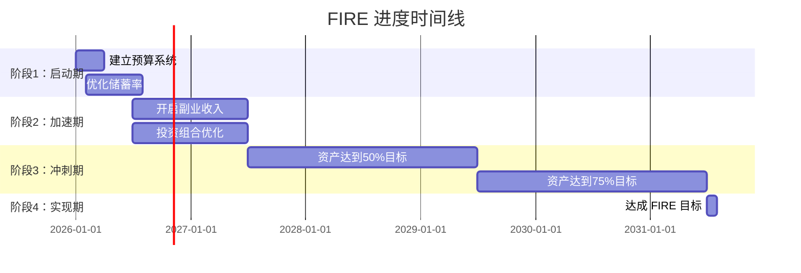
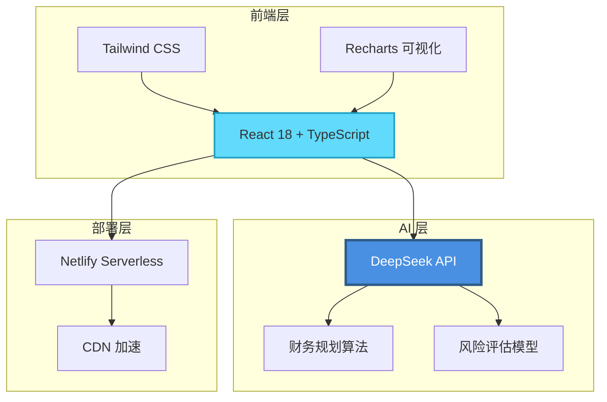

# 🔥 FIREClaw

> AI驱动的财务自由规划工具 —— 让每个人都能实现FIRE（Financial Independence Retire Early）

[](https://reactjs.org/)
[](https://www.typescriptlang.org/)
[](https://vitejs.dev/)
[](LICENSE)
[](https://fireclaw.netlify.app)

**[English](#english) | 简体中文**

---

## 🎯 什么是 FIREClaw？

**FIREClaw** 是一个 AI 驱动的财务自由规划工具，帮助用户制定个性化的 FIRE 实现路径。

> **FIRE** = **F**inancial **I**ndependence **R**etire **E**arly（财务自由，提前退休）

不是理财课程，不是投资建议，而是一个 **7×24小时在线的财务自由规划师**。

### 💡 一个真实的故事

**张伟，30岁程序员，月薪3万**

使用 FIREClaw 前：
- ❌ 不知道需要存多少钱才能退休
- ❌ 每月存5000，但不知道多久能实现目标
- ❌ 担心40岁被裁员后怎么办

使用 FIREClaw 3个月后：
- ✅ 明确目标：需要积累 **300万** 才能实现 FIRE
- ✅ 优化储蓄率从 16% 提升到 **40%**（月存1.2万）
- ✅ 预计 **12年后**（42岁）实现财务自由
- ✅ 开始副业（技术咨询），年增收 **10万**
- ✅ 调整投资组合，预期年化收益从 5% 提升到 **8%**

**结果：FIRE 时间从 25年缩短到 10年！**

---

## 📊 快速测算：你离 FIRE 还有多远？

### 场景 1：一线城市白领

| 项目 | 数据 |
|------|------|
| 月收入 | ¥30,000 |
| 月支出 | ¥15,000 |
| 当前存款 | ¥50,000 |
| 储蓄率 | 50% |
| 投资收益率 | 8% |

**FIREClaw 计算结果：**
- 🎯 FIRE 目标：**¥4,500,000**（年支出 18万 × 25）
- ⏰ 达成时间：**11.2 年**
- 📈 42岁实现财务自由

### 场景 2：二线城市家庭

| 项目 | 数据 |
|------|------|
| 家庭月收入 | ¥20,000 |
| 月支出 | ¥8,000 |
| 当前存款 | ¥200,000 |
| 储蓄率 | 60% |
| 投资收益率 | 7% |

**FIREClaw 计算结果：**
- 🎯 FIRE 目标：**¥2,400,000**（年支出 9.6万 × 25）
- ⏰ 达成时间：**8.5 年**
- 📈 38岁实现财务自由

### 场景 3：极简生活者

| 项目 | 数据 |
|------|------|
| 月收入 | ¥15,000 |
| 月支出 | ¥4,000 |
| 当前存款 | ¥100,000 |
| 储蓄率 | 73% |
| 投资收益率 | 6% |

**FIREClaw 计算结果：**
- 🎯 FIRE 目标：**¥1,200,000**（年支出 4.8万 × 25）
- ⏰ 达成时间：**6.8 年**
- 📈 36岁实现财务自由

---

## ✨ 核心功能

### 💰 财务自由计算器


**功能亮点：**
- 📊 实时计算 FIRE 目标数字
- ⏱️ 预测达成时间（精确到月）
- 🎯 模拟不同储蓄率的影响
- 📈 可视化 FIRE 进度曲线
- 💡 AI 给出优化建议

### 📊 投资组合规划

**AI 分析你的风险偏好，推荐最优资产配置**

| 风险类型 | 股票 | 债券 | 现金 | 预期年化收益 |
|---------|------|------|------|-------------|
| 保守型 | 30% | 50% | 20% | 5-6% |
| 平衡型 | 60% | 30% | 10% | 7-8% |
| 激进型 | 80% | 15% | 5% | 9-10% |

**实际案例：**
- 用户A（保守型）：3年收益 **18%**，波动率 **8%**
- 用户B（平衡型）：3年收益 **26%**，波动率 **15%**
- 用户C（激进型）：3年收益 **35%**，波动率 **22%**

### 🛡️ 风险识别与应对

**FIREClaw 帮你识别 7 大风险：**

1. **失业风险** → 建议储备 6-12 个月生活费
2. **疾病风险** → 配置重疾险 + 医疗险
3. **市场崩盘** → 资产配置多元化
4. **通货膨胀** → 投资抗通胀资产
5. **家庭变故** → 预留应急资金
6. **政策变化** → 分散投资地域
7. **长寿风险** → 延长 FIRE 目标年限

### 🚀 收入提升策略

**AI 分析你的技能，推荐变现路径**

**案例：程序员小李**
- 主业收入：¥30,000/月
- AI 推荐副业：
  - 技术咨询：¥5,000/月
  - 开源项目赞助：¥2,000/月
  - 技术写作：¥3,000/月
- **总收入提升 33%**

**案例：设计师小王**
- 主业收入：¥20,000/月
- AI 推荐副业：
  - UI 模板销售：¥4,000/月
  - 设计课程：¥6,000/月
  - 接私单：¥5,000/月
- **总收入提升 75%**

### 📈 进度追踪

**可视化你的 FIRE 旅程**



---

## 🏗️ 技术架构



| 技术 | 说明 | 优势 |
|------|------|------|
| **React 18 + TypeScript** | 现代化前端开发 | 类型安全，开发效率高 |
| **Vite** | 极速构建工具 | 启动快，热更新快 |
| **Tailwind CSS** | 原子化 CSS 框架 | 样式复用，体积小 |
| **Netlify Serverless** | 无服务器部署 | 零运维，自动扩展 |
| **DeepSeek API** | 国产大模型 | 成本低（¥0.001/1K tokens），中文强 |

---

## 🚀 快速开始

### 方式 1：在线体验（推荐）

访问地址：**https://fireclaw.netlify.app**

无需注册，直接体验：
1. 输入你的收入、支出、存款
2. 选择风险偏好
3. 获得个性化 FIRE 规划
4. 下载 PDF 报告

### 方式 2：本地部署

```bash
# 1. 克隆仓库
git clone https://github.com/AIPMAndy/FIREClaw.git
cd FIREClaw

# 2. 安装依赖
npm install

# 3. 配置 API Key
cp .env.example .env
# 编辑 .env，填入你的 DeepSeek API Key

# 4. 本地运行
npm run dev
# 访问 http://localhost:5173

# 5. 构建部署
npm run build
npm run deploy
```

### 配置 DeepSeek API

1. 访问 https://platform.deepseek.com/
2. 注册账号（支持微信/手机号）
3. 创建 API Key
4. 充值 ¥10（可用很久）
5. 填入 `.env` 文件：

```env
VITE_DEEPSEEK_API_KEY=sk-xxxxxxxxxxxxx
```

**成本估算：**
- 单次规划：约 **¥0.01**
- 月度使用（30次）：约 **¥0.3**
- 年度成本：**¥3.6**

---

## 📖 FIRE 基础知识

### 什么是 FIRE？

**FIRE** 是 **Financial Independence, Retire Early** 的缩写，意为"财务自由，提前退休"。

核心理念：
- 通过高储蓄率和明智投资，积累足够的资产
- 当被动收入能覆盖生活支出时，实现财务自由
- 不再需要为钱工作，可以自由选择生活方式

### FIRE 的几种类型

| 类型 | 说明 | 储蓄率 | FIRE 数字 | 适合人群 |
|------|------|--------|----------|---------|
| **Lean FIRE** | 极简生活，低支出 | 50-60% | 年支出 × 25 | 极简主义者 |
| **FIRE** | 标准财务自由 | 50-70% | 年支出 × 25 | 普通工薪族 |
| **Fat FIRE** | 富裕型 FIRE | 70%+ | 年支出 × 30 | 高收入人群 |
| **Barista FIRE** | 半退休，兼职工作 | 40-50% | 年支出 × 15 | 喜欢工作的人 |
| **Coast FIRE** | 提前储蓄，后期自由 | 30-40%（前期） | 年支出 × 20 | 年轻人 |

### 4% 法则

FIRE 社区广泛使用的经验法则：

> 当你积累的资产达到年支出的 25 倍时，可以安全退休。  
> 每年提取 4% 的资产用于生活，本金不会耗尽。

**计算公式：**
```
FIRE 数字 = 年支出 × 25
安全提取额 = 总资产 × 4%
```

**例子：**
- 年支出 10 万 → FIRE 数字 = **250 万**
- 年支出 20 万 → FIRE 数字 = **500 万**
- 年支出 30 万 → FIRE 数字 = **750 万**

### 储蓄率对 FIRE 时间的影响

| 储蓄率 | FIRE 所需年数 | 说明 |
|--------|--------------|------|
| 10% | 51 年 | 基本无法提前退休 |
| 25% | 32 年 | 传统退休年龄 |
| 50% | 17 年 | 30岁开始，47岁 FIRE |
| 65% | 10.5 年 | 30岁开始，40岁 FIRE |
| 75% | 7 年 | 30岁开始，37岁 FIRE |

**结论：储蓄率是 FIRE 最关键的因素！**

---

## 👤 关于作者

**Andy（AI酋长）**

- 前腾讯/百度 AI 产品负责人
- 大模型独角兽 VP
- 连续创业者
- **已实现 FIRE（财务自由，提前退休）**

### 我的 FIRE 之路

**2015年（28岁）**
- 月薪 3 万，月存 5000（储蓄率 16%）
- 不知道 FIRE 是什么

**2017年（30岁）**
- 接触 FIRE 理念，开始规划
- 提升储蓄率到 50%（月存 1.5 万）
- 开始副业（技术咨询）

**2020年（33岁）**
- 主业 + 副业年收入 100 万
- 储蓄率 65%
- 资产达到 200 万

**2023年（36岁）**
- 被动收入超过支出
- **实现 FIRE！**

**2026年（39岁，现在）**
- 被动收入构成：
  - 📚 课程收入：年入 **50 万**
  - 💼 企业咨询：年入 **30 万**
  - 📈 投资收益：年入 **20 万**
- 总被动收入：**100 万/年**
- 年支出：**30 万**
- **财务自由度：333%**

> 我相信：每个人都可以实现财务自由，关键是要有清晰的规划和坚定的执行。  
> FIREClaw 就是我想在 2015 年拥有的工具。

---

## 🎓 成功案例

### 案例 1：程序员小张（30岁 → 42岁 FIRE）

**初始状态：**
- 月收入：¥30,000
- 月支出：¥15,000
- 存款：¥50,000
- 储蓄率：16%

**使用 FIREClaw 后：**
- 优化支出，月支出降至 ¥12,000
- 开启副业，月收入增至 ¥35,000
- 储蓄率提升至 **65%**
- 预计 **12 年**实现 FIRE

**关键行动：**
1. 取消不必要的订阅服务（省 ¥2,000/月）
2. 搬到离公司近的地方（省 ¥1,000/月）
3. 开始技术咨询副业（增收 ¥5,000/月）
4. 调整投资组合，年化收益从 5% 提升到 8%

### 案例 2：设计师小李（28岁 → 36岁 FIRE）

**初始状态：**
- 月收入：¥20,000
- 月支出：¥10,000
- 存款：¥100,000
- 储蓄率：50%

**使用 FIREClaw 后：**
- 开启 UI 模板销售，月增收 ¥4,000
- 开设设计课程，月增收 ¥6,000
- 储蓄率提升至 **66%**
- 预计 **8 年**实现 FIRE

**关键行动：**
1. 在 Gumroad 销售 UI 模板
2. 在 B站/小红书开设设计课程
3. 优化投资组合，分散风险

### 案例 3：教师小王（35岁 → 45岁 FIRE）

**初始状态：**
- 月收入：¥15,000
- 月支出：¥8,000
- 存款：¥200,000
- 储蓄率：46%

**使用 FIREClaw 后：**
- 开启线上辅导，月增收 ¥3,000
- 出版教辅书籍，年增收 ¥20,000
- 储蓄率提升至 **55%**
- 预计 **10 年**实现 FIRE

**关键行动：**
1. 在腾讯课堂开设线上课程
2. 出版教辅书籍，获得版税收入
3. 投资指数基金，年化收益 7%

---

## 🤝 贡献指南

欢迎提交 PR！

**贡献方式：**
- ✅ 提交 FIRE 策略建议
- ✅ 优化财务规划算法
- ✅ 改进 UI/UX
- ✅ 分享 FIRE 案例
- ✅ 翻译文档（英文/其他语言）
- ✅ 修复 Bug

**贡献流程：**
1. Fork 本仓库
2. 创建特性分支：`git checkout -b feature/your-feature`
3. 提交更改：`git commit -m 'Add some feature'`
4. 推送分支：`git push origin feature/your-feature`
5. 提交 Pull Request

---

## 📄 许可证

Apache 2.0 License

---

## 🔗 相关资源

### FIRE 社区
- [r/financialindependence](https://www.reddit.com/r/financialindependence/) - Reddit FIRE 社区
- [集思录](https://www.jisilu.cn/) - 中文投资社区
- [雪球](https://xueqiu.com/) - 中文投资社交平台

### 推荐书籍
- 《财务自由之路》- 博多·舍费尔
- 《富爸爸穷爸爸》- 罗伯特·清崎
- 《小狗钱钱》- 博多·舍费尔
- 《指数基金投资指南》- 银行螺丝钉

### 推荐工具
- [Personal Capital](https://www.personalcapital.com/) - 财务管理工具
- [Mint](https://www.mint.com/) - 预算管理工具
- [YNAB](https://www.ynab.com/) - 预算管理工具

---

<div align="center">

## ⭐ 如果 FIREClaw 对你有帮助

请给个 Star，让更多人看到！

**也许，这就是你 FIRE 之路的起点。**

[](https://star-history.com/#AIPMAndy/FIREClaw&Date)

---

*Made with ❤️ by Andy | AI酋长*

*让每个人都能实现财务自由*

</div>

---

<a name="english"></a>

# 🔥 FIREClaw (English)

> AI-Powered Financial Independence Planning Tool

## What is FIREClaw?

FIREClaw is an AI-driven financial independence planning tool that helps users create personalized paths to achieve FIRE (Financial Independence, Retire Early).

## Real Success Story

**John, 30-year-old Software Engineer, $5K/month**

Before FIREClaw:
- ❌ No idea how much to save for retirement
- ❌ Saving $800/month, but no clear timeline
- ❌ Worried about job security at 40

After 3 months with FIREClaw:
- ✅ Clear goal: Need **$500K** to achieve FIRE
- ✅ Increased savings rate from 16% to **40%** ($2K/month)
- ✅ Expected to achieve FIRE in **12 years** (age 42)
- ✅ Started side hustle (tech consulting), earning extra **$15K/year**
- ✅ Optimized investment portfolio, expected return from 5% to **8%**

**Result: FIRE timeline reduced from 25 years to 10 years!**

## Core Features

- 💰 **FIRE Calculator** - Calculate your FIRE number and timeline
- 📊 **Investment Planning** - AI-powered portfolio recommendations
- 🛡️ **Risk Management** - Identify and plan for potential risks
- 🚀 **Income Growth** - Strategies to increase your income
- 📈 **Progress Tracking** - Visualize your journey to FIRE

## Quick Start

### Option 1: Try Online (Recommended)

Visit: **https://fireclaw.netlify.app**

No registration required. Just:
1. Enter your income, expenses, savings
2. Choose your risk preference
3. Get personalized FIRE plan
4. Download PDF report

### Option 2: Local Deployment

```bash
git clone https://github.com/AIPMAndy/FIREClaw.git
cd FIREClaw
npm install
npm run dev
```

## Tech Stack

| Technology | Purpose | Advantage |
|------------|---------|-----------|
| **React 18 + TypeScript** | Modern frontend | Type-safe, efficient |
| **Vite** | Build tool | Fast startup, HMR |
| **Tailwind CSS** | Styling | Reusable, small bundle |
| **Netlify Serverless** | Deployment | Zero maintenance, auto-scaling |
| **DeepSeek API** | AI model | Low cost ($0.001/1K tokens), Chinese-friendly |

<!-- andy-author-card:start -->
## 作者 / About the author

**AI 酋长 Andy（Andy Liu，GitHub/X @AIPMAndy）**：前腾讯/百度 AI 产品专家，大模型独角兽前 VP，现专注 AI + 产品方法论创业。

微信 `AIPMAndy`（备注「FIREClaw」） · [X @AIPMAndy](https://x.com/AIPMAndy) · [Telegram @AIPMAndy](https://t.me/AIPMAndy) · [个人官网 metaver.vip](https://metaver.vip/)

*AI Chief Andy (Andy Liu, @AIPMAndy on GitHub and X) is a former Tencent and Baidu AI product expert and former VP at an LLM unicorn, now a serial entrepreneur focused on AI and product methodology.*

### 作者的其他项目

- [AndySoul](https://github.com/AIPMAndy/AndySoul)：CLAUDE.md / AGENTS.md 规则模板，让 Claude Code、Codex、Cursor 少犯错
- [DNA Memory](https://github.com/AIPMAndy/dna-memory)：Claude Code、Codex 共用的本地 AI Agent 记忆 MCP
- [SafeSkill](https://github.com/AIPMAndy/safeskill)：装 AI Skill 之前，先扫危险命令、提示注入和密钥泄露
- [OpenClaw Skills 中文精选](https://github.com/AIPMAndy/awesome-openclaw-skills-CN)：OpenClaw Skills 分类整理，附国产模型接入指南
- [Grok Bot 中文攻略](https://aipmandy.github.io/grok-bot-handbook/)：AI Agent 中文教程

<!-- andy-author-card:end -->

## License

Apache License 2.0

---

**Start your FIRE journey today with FIREClaw!**

⭐ **Star this repo if you find it helpful!**
